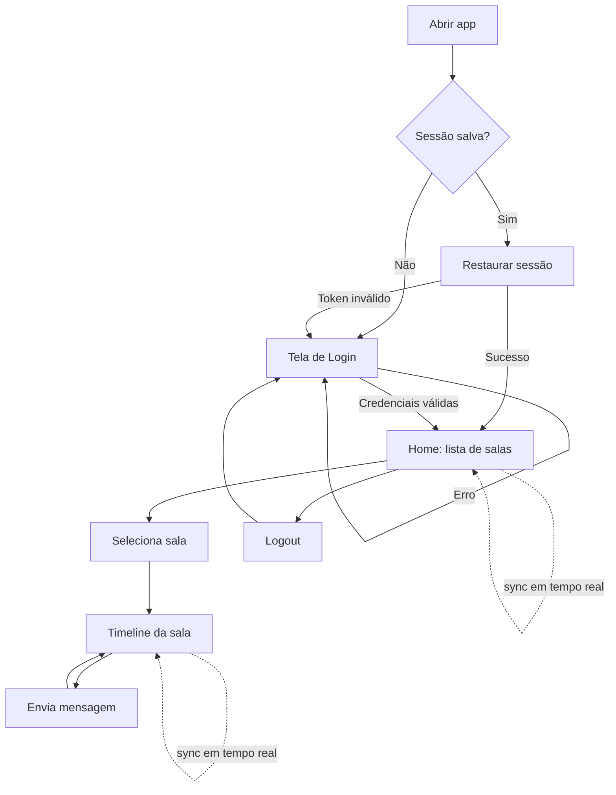

# Documento de Visão — Cliente de Mensageria Desktop (Matrix)

| Item | Valor |
|---|---|
| Projeto | Cliente de mensageria desktop |
| Plataformas | macOS, Windows, Linux |
| Stack | Flutter (UI) + Rust (Matrix Rust SDK) via Flutter Rust Bridge |
| Arquitetura | MVVM + Clean Architecture, com GetX |
| Versão do documento | 1.0 — 02/10/2026 |

---

## 1. Propósito

Este documento descreve **o que** será construído, **para quem**, **por que** e **com quais limites**. Ele serve de referência para as decisões técnicas descritas em [`02-arquitetura.md`](02-arquitetura.md) e para priorizar o trabalho, já que o desafio deixa claro que não se espera um produto completo, e sim uma solução **bem estruturada e preparada para evoluir**.

## 2. Contexto e problema

O protocolo [Matrix](https://matrix.org) é um padrão aberto e descentralizado para comunicação em tempo real. Os usuários se conectam a um *homeserver* (ex.: `matrix.org` ou um Synapse próprio) e conversam em *salas*.

O desafio é construir um **cliente desktop multiplataforma** que:

- entregue os fluxos essenciais de mensageria;
- delegue a comunicação com o Matrix a uma camada nativa em **Rust** (`matrix-rust-sdk`), exposta ao Flutter via **Flutter Rust Bridge (FRB)**;
- trate **segurança**, **erros** e **experiência do usuário** como requisitos de primeira classe.

## 3. Objetivos

| # | Objetivo | Como será medido |
|---|---|---|
| O1 | Demonstrar arquitetura limpa, testável e evolutiva | Camadas desacopladas; domínio sem dependência de Flutter/GetX/Rust; testes unitários de casos de uso e ViewModels |
| O2 | Entregar os 5 fluxos obrigatórios funcionando ponta a ponta | Login → salas → mensagens → atualização em tempo real → logout/restauração |
| O3 | Tratar credenciais com segurança | Tokens apenas no cofre do SO; banco local do SDK criptografado; nada sensível em logs |
| O4 | Boa experiência em desktop | Layout em dois painéis, estados de carregamento/erro/vazio, atalhos de teclado básicos |
| O5 | Documentar decisões e limitações com transparência | README, ADRs e seção de limitações |

## 4. Stakeholders e personas

| Stakeholder | Interesse |
|---|---|
| Avaliadores técnicos | Clareza de arquitetura, qualidade de código, testes, decisões justificadas |
| Usuário final | Entrar, ver conversas e trocar mensagens de forma fluida e segura |

**Persona — "Usuário Matrix de desktop"**: já possui (ou cria) uma conta em um homeserver, usa o computador como principal ferramenta de trabalho e espera que o app lembre sua sessão ao reabrir, sem precisar digitar a senha toda vez.

## 5. Escopo

### 5.1 Dentro do escopo (obrigatório pelo desafio)

| ID | Requisito funcional | Descrição |
|---|---|---|
| RF01 | Autenticação | Login com *homeserver URL*, usuário e senha (`m.login.password`). Validação de campos e mensagens de erro claras (servidor inválido, credenciais erradas, sem rede). |
| RF02 | Listagem de salas | Exibir salas em que o usuário participa, com nome, avatar/inicial, prévia da última mensagem e contador de não lidas (quando disponível). |
| RF03 | Seleção de sala | Ao selecionar uma sala, abrir sua *timeline* no painel de conversa. |
| RF04 | Visualização de mensagens | Exibir mensagens de texto com remetente, horário e agrupamento por autor; paginação para mensagens antigas (*back-pagination*). |
| RF05 | Envio de mensagens | Enviar mensagens de texto (`m.text`), com estado local "enviando / enviado / falhou" e opção de reenviar. |
| RF06 | Atualização das conversas | Sincronização contínua (*sync loop*) que atualiza lista de salas e timeline em tempo real. |
| RF07 | Encerramento de sessão | Logout que invalida o token no servidor e remove dados locais (tokens e banco do SDK). |
| RF08 | Restauração de sessão | Ao reabrir o app, restaurar a sessão salva sem pedir senha; se inválida, voltar ao login. |

### 5.2 Desejável (se houver tempo)

- Indicador de conexão/sincronização (online, sincronizando, offline).
- Busca/filtro de salas por nome.
- Atalhos de teclado (`Enter` envia, `Shift+Enter` quebra linha, `Ctrl/Cmd+K` busca).
- Tema claro/escuro seguindo o sistema.
- Exibição de mensagens não-texto como placeholder (“imagem”, “arquivo”).

### 5.3 Fora do escopo (nesta entrega)

- Criação de conta, recuperação de senha, SSO/OIDC.
- Verificação de dispositivos e gerenciamento de chaves E2EE pela UI (o SDK cuida da criptografia, mas a verificação interativa não será implementada).
- Envio de mídia, reações, edição, respostas em thread, chamadas de voz/vídeo.
- Criação/convite/administração de salas.
- Notificações nativas do sistema operacional.
- Múltiplas contas simultâneas.

> Os itens fora do escopo serão registrados na seção de **limitações** do README, junto com a ideia de como a arquitetura os suportaria.

## 6. Requisitos não funcionais

| ID | Categoria | Requisito |
|---|---|---|
| RNF01 | Arquitetura | MVVM + Clean Architecture; regras de negócio isoladas em casos de uso; dependências apontando para o domínio. |
| RNF02 | Princípios | SOLID e Clean Code aplicados de forma pragmática (ver documento de arquitetura). |
| RNF03 | Gerência de estado | GetX (`GetxController` como ViewModel, `Rx`/`Obx` para reatividade, `Bindings` para injeção de dependência). |
| RNF04 | Integração nativa | Toda comunicação Matrix em Rust (`matrix-rust-sdk`) exposta via Flutter Rust Bridge v2. |
| RNF05 | Segurança | Access token e chave do banco local guardados no cofre do SO (Keychain / Credential Manager / libsecret); banco do SDK (SQLite) criptografado; somente HTTPS; logs sem dados sensíveis. |
| RNF06 | Desempenho | UI nunca bloqueada por I/O: chamadas ao Rust são assíncronas; listas grandes com `ListView.builder`; sync roda fora da *UI thread*. |
| RNF07 | Resiliência | Erros tipados de ponta a ponta (Rust → Dart → UI); reconexão automática do sync; envio com retry manual. |
| RNF08 | Testabilidade | Domínio e ViewModels testáveis sem Rust e sem Flutter engine (mocks das interfaces). |
| RNF09 | Portabilidade | Build para macOS, Windows e Linux com instruções no README. |
| RNF10 | Qualidade | Lints estritos, formatação padrão (`dart format`, `cargo fmt`, `cargo clippy`), sem *warnings*. |

## 7. Fluxos principais do usuário



### Layout da tela principal (desktop)

```
┌───────────────────────────────────────────────────────────────┐
│ ● @usuario:matrix.org                         [sync ●] [Sair] │
├───────────────────┬───────────────────────────────────────────┤
│ 🔍 Buscar salas    │  # Nome da sala                           │
│───────────────────│───────────────────────────────────────────│
│ ▸ Sala A      (3) │  Alice   10:02                            │
│   última msg...   │    Olá, tudo bem?                         │
│ ▸ Sala B          │  Bob     10:03                            │
│   última msg...   │    Tudo certo!                            │
│ ▸ Sala C          │                                           │
│                   │───────────────────────────────────────────│
│                   │  [ Digite uma mensagem...        ] [ ➤ ]  │
└───────────────────┴───────────────────────────────────────────┘
```

## 8. Premissas e restrições

- **Restrição**: comunicação Matrix obrigatoriamente em Rust com `matrix-rust-sdk` + `flutter_rust_bridge`.
- **Premissa**: os testes manuais usarão uma conta em `matrix.org` ou um Synapse local via Docker (instruções no README).
- **Premissa**: o ambiente de build terá Flutter estável, toolchain Rust estável e as dependências nativas de cada SO (ex.: `libsecret-1-dev` no Linux).
- **Restrição de tempo**: prioridade é qualidade de arquitetura e fluxos essenciais, não quantidade de funcionalidades.

## 9. Riscos

| Risco | Impacto | Mitigação |
|---|---|---|
| Complexidade do build Rust + FRB em 3 SOs | Alto | Usar o template oficial do FRB (`cargokit`), documentar pré-requisitos, validar build cedo |
| API do `matrix-rust-sdk` em evolução (versões 0.x) | Médio | Isolar o SDK atrás de uma API Rust própria e pequena (*facade*); fixar versões no `Cargo.lock` |
| Salas criptografadas sem chaves (mensagens "não decifráveis") | Médio | Exibir placeholder claro e registrar como limitação |
| Streams Rust → Dart (sync) com vazamento de recursos | Médio | Ciclo de vida explícito: `onClose` dos ViewModels cancela assinaturas; Rust encerra tasks no logout |
| Acoplamento excessivo ao GetX | Médio | GetX restrito à camada de apresentação e ao *composition root*; domínio e dados em Dart puro |

## 10. Priorização (MoSCoW)

| Prioridade | Itens |
|---|---|
| **Must** | RF01–RF08, armazenamento seguro, tratamento de erros, testes de domínio/ViewModel, README |
| **Should** | Indicador de sync, estados vazios/erro bem desenhados, back-pagination, testes de widget |
| **Could** | Busca de salas, atalhos de teclado, tema escuro, placeholders de mídia |
| **Won't (agora)** | Itens da seção 5.3 |

## 11. Plano de entrega incremental

| Fase | Entrega | Resultado verificável |
|---|---|---|
| 0 | Esqueleto: projeto Flutter desktop + crate Rust + FRB gerando bindings | `flutter run -d macos` chama uma função Rust de teste |
| 1 | Domínio + contratos (entidades, repositórios abstratos, casos de uso, `Result`/`Failure`) | Testes unitários do domínio passando |
| 2 | Autenticação + armazenamento seguro + restauração/logout (RF01, RF07, RF08) | Login real em homeserver; reabrir app mantém sessão |
| 3 | Sync + lista de salas (RF02, RF03, RF06) | Salas aparecem e se atualizam em tempo real |
| 4 | Timeline + envio (RF04, RF05) | Conversa funcional com estados de envio |
| 5 | Polimento de UX, testes de widget, README, ADRs e limitações | Repositório pronto para avaliação |

## 12. Critérios de sucesso

- Os 8 requisitos funcionais obrigatórios funcionam ponta a ponta em pelo menos um SO, com build documentado para os três.
- Nenhuma credencial em texto plano em disco ou em logs.
- Domínio e ViewModels cobertos por testes unitários.
- Um avaliador consegue clonar, configurar e executar seguindo apenas o README.
- Decisões técnicas e limitações estão documentadas.
