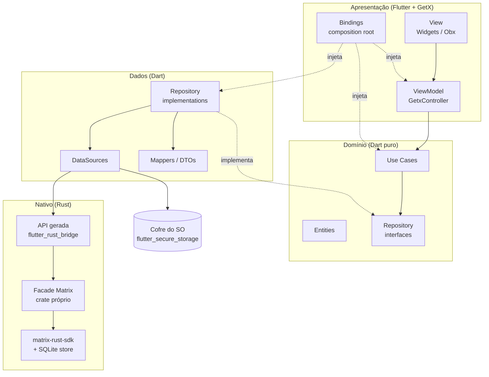
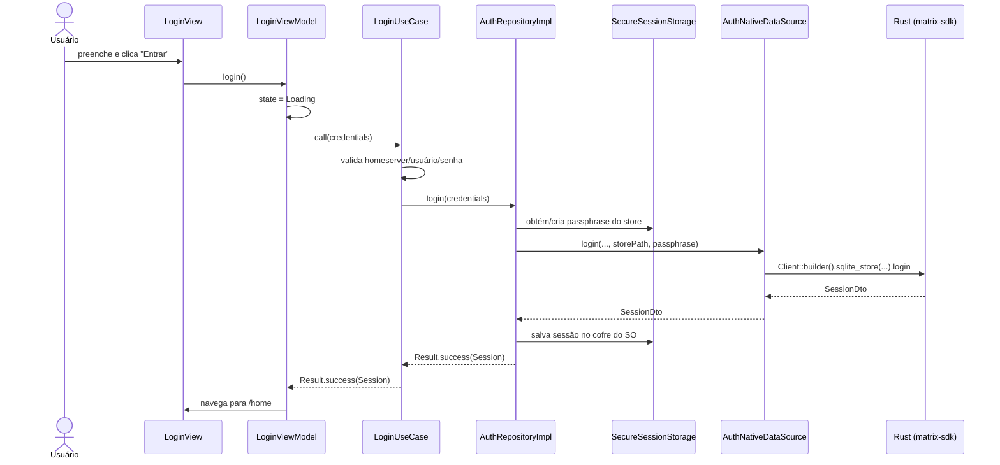
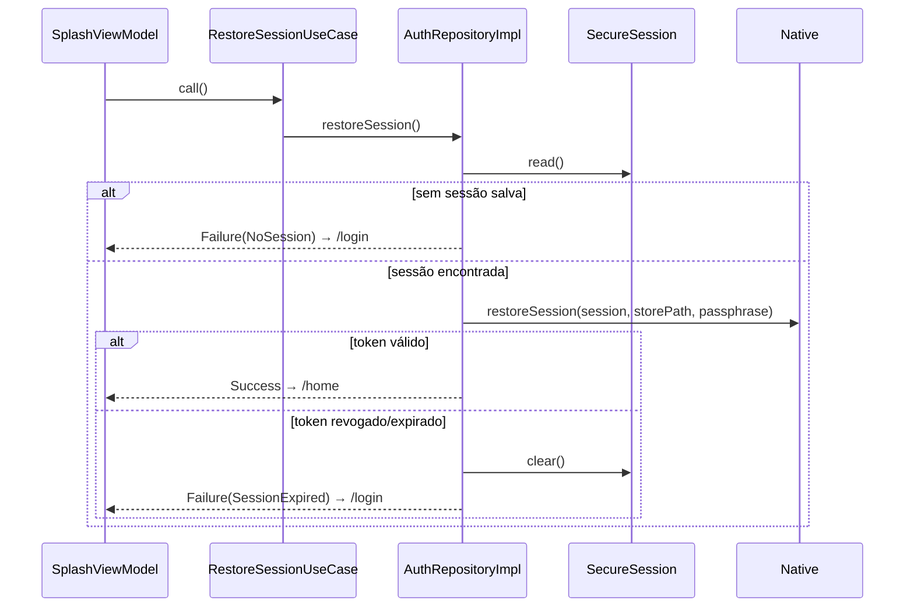
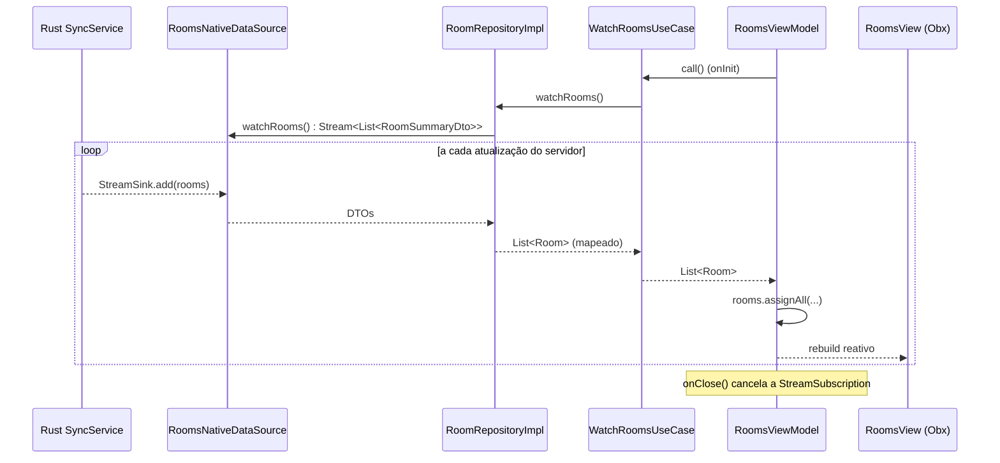

# Arquitetura — Cliente de Mensageria Desktop (Matrix)

> Complementa o [Documento de Visão](01-documento-de-visao.md). Aqui está o **como**: camadas, responsabilidades, regras de dependência, fluxos e convenções.

---

## 1. Visão geral

A aplicação combina **MVVM** (na apresentação) com **Clean Architecture** (na organização das camadas). O GetX é usado para **estado reativo, injeção de dependências e rotas**, mas fica **restrito às bordas** (apresentação e *composition root*), para que o núcleo do sistema continue em Dart puro.



**Regra de dependência:** as setas de código-fonte apontam sempre para dentro, em direção ao **domínio**. O domínio não conhece Flutter, GetX, FRB nem Rust.

## 2. Camadas e responsabilidades

### 2.1 Nativo (Rust)

| Responsabilidade | Detalhe |
|---|---|
| Encapsular o `matrix-rust-sdk` | Um crate próprio (`native/`) expõe uma **API pequena e estável** (facade), em vez de vazar tipos do SDK para o Dart. |
| Sessão e sync | Cria/restaura o `Client`, executa o *sync loop* (preferencialmente via `matrix-sdk-ui`: `SyncService`, `RoomListService` e `Timeline`). |
| Persistência do SDK | Store SQLite do SDK (`matrix-sdk-sqlite`) **criptografado com passphrase** fornecida pelo Dart. |
| Streams | Emite atualizações para o Dart via `StreamSink` do FRB (lista de salas, timeline, estado do sync). |
| Erros | Converte erros do SDK num `enum MatrixError` próprio, que o FRB transforma em exceção tipada no Dart. |

Exemplo de superfície da API (`native/src/api/`):

```rust
pub async fn login(homeserver: String, username: String, password: String, store_path: String, passphrase: String) -> Result<SessionDto, MatrixError>;
pub async fn restore_session(session: SessionDto, store_path: String, passphrase: String) -> Result<(), MatrixError>;
pub async fn logout() -> Result<(), MatrixError>;

pub fn watch_sync_state(sink: StreamSink<SyncStateDto>) -> Result<(), MatrixError>;
pub fn watch_rooms(sink: StreamSink<Vec<RoomSummaryDto>>) -> Result<(), MatrixError>;
pub fn watch_timeline(room_id: String, sink: StreamSink<TimelineDiffDto>) -> Result<(), MatrixError>;

pub async fn watch_timeline(room_id: String, sink: StreamSink<Vec<MessageDto>>);
pub async fn paginate_backwards(room_id: String, count: u16) -> Result<bool, MatrixError>;
pub async fn send_text(room_id: String, body: String) -> Result<(), MatrixError>;
pub async fn retry_send(room_id: String, transaction_id: String) -> Result<(), MatrixError>;
pub async fn mark_as_read(room_id: String) -> Result<(), MatrixError>;
```

> **Erros em streams:** o FRB 2 entrega erros de `StreamSink` ao Dart sempre como `AnyhowException`, independentemente do tipo enviado. Por isso o Rust envia `MatrixError::into_stream_error()` (mensagem `matrix_error:<Kind>:<detalhe>`) e o `guardNativeStream` reconstrói a `NativeException` tipada.

> **Timelines:** o `sync_runtime` mantém uma `Timeline` por sala aberta, compartilhada entre stream, paginação, envio e reenvio (necessário para achar o *local echo* a reenviar), e descarta todas no logout.

> Os DTOs gerados pelo FRB **nunca** chegam ao domínio — os *mappers* da camada de dados os convertem em entidades.

### 2.2 Dados (Dart)

| Componente | Responsabilidade |
|---|---|
| `*NativeDataSource` (um por feature, ex.: `AuthNativeDataSource`) | *Wrapper* fino da API gerada pelo FRB. Junto com `core/native`, são os únicos pontos que importam código gerado. Toda chamada passa por `guardNative`, que converte o erro do Rust em `NativeException`. |
| `SessionStorage` | Lê/grava/apaga a sessão (`StoredSession`, com tokens) e a passphrase do store no cofre do SO. |
| `*RepositoryImpl` | Implementa as interfaces do domínio, orquestra data sources, aplica *mappers* e devolve `Result<T>` (nunca lança exceção para cima). Usa `guardResult` (Futures) e `asResults` (streams), que convertem e registram as exceções. |
| Mappers | Funções puras DTO ⇄ Entidade; fáceis de testar. |

### 2.3 Domínio (Dart puro)

| Componente | Responsabilidade |
|---|---|
| Entidades | `Session`, `LoginCredentials`, `Room`, `SyncStatus`, `Message` + `MessageContent` (sealed) — imutáveis, com igualdade por valor. `Session` não expõe o access token. |
| Interfaces de repositório | `AuthRepository`, `RoomRepository`, `MessageRepository`. |
| Casos de uso | Uma classe por intenção do usuário, com um único método `call`. |
| `Result<T>` / `Failure` | Modelo explícito de sucesso/erro, com `sealed class` para *pattern matching* exaustivo. |

Casos de uso previstos:

| Feature | Casos de uso |
|---|---|
| auth | `LoginUseCase`, `RestoreSessionUseCase`, `LogoutUseCase` |
| rooms | `WatchRoomsUseCase`, `WatchSyncStatusUseCase` |
| chat | `WatchTimelineUseCase`, `LoadOlderMessagesUseCase`, `SendMessageUseCase`, `RetryMessageUseCase`, `MarkRoomAsReadUseCase` |

### 2.4 Apresentação (Flutter + GetX) — MVVM

| Papel MVVM | Implementação | Regras |
|---|---|---|
| **View** | `GetView<XViewModel>` / widgets | Apenas renderiza estado e repassa eventos. Sem regra de negócio, sem chamadas a repositórios. |
| **ViewModel** | `GetxController` | Expõe estado observável (`Rx`) e comandos (`login()`, `send()`); depende **apenas de casos de uso**. |
| **Model** | Entidades do domínio | Vêm dos casos de uso. |
| **Binding** | `Bindings` do GetX | *Composition root* da tela: instancia e injeta dependências. Único lugar onde se usa `Get.put/lazyPut/find`. |
| **Middleware** | `GetMiddleware` | `AuthGuard` redireciona para login quando não há sessão. |

Estado de tela modelado com `sealed class`:

```dart
sealed class ViewState<T> { const ViewState(); }
final class Idle<T> extends ViewState<T> { const Idle(); }
final class Loading<T> extends ViewState<T> { const Loading(); }
final class Success<T> extends ViewState<T> { const Success(this.data); final T data; }
final class Failed<T> extends ViewState<T> { const Failed(this.failure); final Failure failure; }
```

## 3. Estrutura de pastas

Organização **feature-first**, com as camadas dentro de cada feature e um `core` compartilhado:

```
desafio-tecnico/
├── docs/
│   ├── 01-documento-de-visao.md
│   ├── 02-arquitetura.md
│   └── adr/                          # Architecture Decision Records
├── flutter_rust_bridge.yaml          # Configuração do codegen do FRB
├── rust_builder/                     # Plugin FFI (cargokit) que compila o crate em cada SO
├── native/                           # Crate Rust (matrix-rust-sdk + FRB)
│   ├── Cargo.toml
│   └── src/
│       ├── api/                      # Funções e DTOs expostos ao Dart (facade)
│       │   ├── auth.rs               # login, restore_session, logout
│       │   ├── rooms.rs              # watch_sync_state, watch_rooms
│       │   ├── timeline.rs           # watch_timeline, paginate_backwards, send_text, retry_send, mark_as_read
│       │   ├── error.rs              # MatrixError { kind, message }
│       │   └── health.rs             # Diagnóstico da ponte
│       ├── client_holder.rs          # Client da sessão ativa (LazyLock/RwLock)
│       ├── sync_runtime.rs           # SyncService, timelines por sala e tarefas dos streams
│       └── error_mapping.rs          # Erros do SDK → MatrixError; erros de stream (ADR 007)
├── lib/
│   ├── main.dart
│   ├── app/
│   │   ├── app_widget.dart           # GetMaterialApp
│   │   ├── routes/                   # app_pages.dart, app_routes.dart
│   │   ├── bindings/initial_binding.dart   # composition root (dependências globais)
│   │   └── middlewares/auth_guard.dart
│   ├── core/
│   │   ├── result/                   # Result<T>, Failure
│   │   ├── errors/                   # Failure (sealed) e ValidationError
│   │   ├── native/
│   │   │   ├── bridge/               # Código gerado pelo FRB (não editar, fora do lint)
│   │   │   ├── native_bridge.dart    # Inicialização da biblioteca Rust
│   │   │   ├── native_call.dart      # guardNative/guardNativeStream: erro do Rust → NativeException
│   │   │   ├── native_exception.dart # NativeException → Failure
│   │   │   └── native_result.dart    # guardResult/asResults: exceção → Result<T> (com log)
│   │   ├── navigation/               # AppNavigator (abstração de navegação)
│   │   ├── storage/                  # AppDirectories (caminho do banco local)
│   │   ├── ui/                       # ViewState, mensagens de falha, datas, widgets/ compartilhados
│   │   └── utils/                    # AppLogger com redação de dados sensíveis
│   └── features/
│       ├── auth/
│       │   ├── domain/   { entities/, repositories/, usecases/ }
│       │   ├── data/     { datasources/, models/, repositories/ }
│       │   └── presentation/ { views/, viewmodels/, bindings/, session_service.dart }
│       ├── home/                     # Shell autenticado: conta/logout e ConversationArea (compõe rooms + chat)
│       ├── rooms/
│       │   └── ... (mesma estrutura)
│       └── chat/
│           └── ... (mesma estrutura)
├── test/                             # Espelha lib/
│   ├── features/auth/domain/...
│   ├── features/auth/presentation/...
│   └── mocks/
└── integration_test/
```

## 4. Fluxos principais

### 4.1 Login



### 4.2 Restauração de sessão (abertura do app)



### 4.3 Atualização em tempo real (sync → UI)



### 4.4 Envio de mensagem

O envio usa *local echo* do `Timeline` do `matrix-sdk-ui`: a mensagem aparece imediatamente como **enviando**, e o próprio stream da timeline atualiza para **enviada** ou **falhou**. O ViewModel não precisa manter uma fila paralela, o que reduz estado duplicado.

- **Reenvio:** `RetryMessageUseCase` só aceita mensagens próprias que falharam. No Rust, `retry_send` destrava o item (`SendHandle::unwedge`, para erros irrecuperáveis) e reativa a fila da sala (desativada pelo SDK após erros de rede).
- **Campo de mensagem:** é limpo assim que o usuário envia; se o caso de uso rejeitar (ex.: mensagem longa demais), o texto volta ao campo com o erro.
- **Leitura:** o `ChatViewModel` envia recibo de leitura quando chega uma nova mensagem confirmada pelo servidor, zerando o contador de não lidas da sala.
- **Apresentação:** `buildTimelineEntries` (função pura) agrupa mensagens seguidas do mesmo autor (janela de 5 min) e insere divisores de dia. A lista é invertida (`reverse: true`) para manter as mais recentes embaixo; rolar perto do topo, ou uma conversa que não preenche a tela, dispara a paginação.

## 5. Tratamento de erros

Os erros são **tipados em toda a cadeia** e convertidos uma única vez em cada fronteira:

```
Rust: matrix_sdk::Error ──► MatrixError (enum próprio)
        │ FRB
Dart: MatrixError (exceção gerada) ──► NativeException          [data source: guardNative]
        ──► Failure (sealed)            [repository → Result<T>]
        ──► mensagem amigável na UI     [ViewModel]
```

```dart
sealed class Failure extends Equatable {
  const Failure([this.details]); // detalhe técnico para log, nunca texto de UI
  final String? details;
}
final class NetworkFailure extends Failure { ... }
final class HomeserverUnreachableFailure extends Failure { ... }
final class InvalidCredentialsFailure extends Failure { ... }
final class NoSessionFailure extends Failure { ... }
final class SessionExpiredFailure extends Failure { ... }
final class RoomNotFoundFailure extends Failure { ... }
final class ValidationFailure extends Failure { final ValidationError reason; }
final class UnexpectedFailure extends Failure { ... }
```

As falhas **não carregam mensagens para o usuário**: o ViewModel traduz cada tipo (e cada `ValidationError`) em texto, mantendo o domínio livre de preocupações de apresentação.

Regras:

- Repositórios **não lançam exceções**: retornam `Result<T>` (`Ok` / `Err`).
- Casos de uso podem produzir `ValidationFailure` antes de chamar o repositório.
- Streams também seguem a regra: emitem `Result<T>` (`Stream<Result<List<Room>>>`), em vez de usar o canal de erro do `Stream`.
- ViewModels fazem `switch` exaustivo sobre `Failure` para escolher a mensagem e a ação (ex.: `SessionExpiredFailure` → redirecionar para login).
- Erros inesperados são registrados pelo logger (com redação) e exibidos de forma genérica.

## 6. Segurança

| Ameaça | Controle |
|---|---|
| Roubo de token em disco | `accessToken` salvo **somente** no cofre do SO via `flutter_secure_storage` (Keychain no macOS, Credential Manager no Windows, libsecret no Linux). |
| Leitura do banco local (mensagens, chaves E2EE) | Store SQLite do SDK criptografado com **passphrase aleatória (32 bytes)**, gerada no primeiro login e guardada no cofre do SO. |
| Vazamento em logs | `AppLogger` central: redige tokens (`syt_…`, `Bearer`), `access_token`/`refresh_token`/`password`/`passphrase`; nada é registrado em release; conteúdo de mensagens nunca é logado. |
| Tráfego interceptado | Somente `https://` aceito para o homeserver (validado no caso de uso); TLS a cargo do SDK. |
| Senha retida em memória | Senha não é persistida; o campo é limpo após o login. |
| Sessão residual após logout | `logout` invalida o token no servidor, apaga o diretório do store e limpa o cofre. |

### 6.1 Comportamentos de sessão (fase 2)

| Situação | Comportamento |
|---|---|
| Login | O banco local anterior é apagado, um novo é criado e criptografado com a passphrase do cofre. A sessão (com tokens) é gravada no cofre. |
| Abrir o app sem rede | A sessão é restaurada mesmo assim (o Rust só rejeita se o servidor responder que o token é inválido). |
| Token revogado/expirado | Sessão e passphrase são apagadas do cofre e o usuário vai para o login. |
| Logout sem rede | Banco local e cofre são limpos mesmo assim; o token pode continuar válido no servidor (limitação registrada). |
| Keychain no macOS | Usa o Keychain clássico (`usesDataProtectionKeychain: false`), que dispensa conta de desenvolvedor Apple/provisioning para rodar localmente. |
| Logs | `SessionDto` (Rust), `StoredSession` e `LoginCredentials` (Dart) têm `Debug`/`toString` que omitem tokens e senha, com testes garantindo. |

## 7. Uso do GetX — decisões e limites

| Recurso | Uso | Justificativa |
|---|---|---|
| `GetxController` | ViewModels | Ciclo de vida (`onInit`/`onClose`) ideal para assinar e cancelar streams. |
| `Rx` + `Obx` | Estado reativo na View | Rebuilds granulares, sem *boilerplate*. |
| `Bindings` | DI por rota | Dependências criadas ao entrar na rota e descartadas ao sair. |
| `GetMaterialApp` + `GetPage` | Rotas nomeadas | Navegação sem `BuildContext` a partir do ViewModel. |
| `GetMiddleware` | `AuthGuard` | Protege rotas autenticadas. |

Complementos usados a partir da fase 2:

- `SessionService` (`GetxService`): guarda a `Session` ativa e é compartilhado entre telas; o `AuthGuard` o consulta.
- `AppNavigator`: interface de navegação injetada nos ViewModels; a implementação (`GetAppNavigator`) usa `Get.offAllNamed`. Assim os ViewModels são testados sem rotas reais.
- Views estendem `GetView<VM>` (que resolve o ViewModel registrado pelo Binding da rota). Formulários com estado local (ex.: `TextEditingController`) ficam em um `StatefulWidget` que recebe o ViewModel por parâmetro.

**O que deliberadamente não faremos:**

- Não importar `package:get` no **domínio** nem na **camada de dados**.
- Não chamar `Get.find()` dentro de ViewModels/Use Cases: as dependências chegam **pelo construtor**. `Get.put/find` só nos `Bindings`.
- Não usar `Get.snackbar`/`Get.dialog` no ViewModel: erros são estado (`ViewState.Failed`, `sendFailure`…) exibido inline pela View. Por isso o serviço `UserFeedback`, previsto inicialmente, não foi necessário (ver ADR 002).

```dart
// Binding — único lugar que conhece o GetX como container
class LoginBinding extends Bindings {
  @override
  void dependencies() {
    Get.lazyPut<LoginUseCase>(() => LoginUseCase(Get.find<AuthRepository>()));
    Get.lazyPut(() => LoginViewModel(loginUseCase: Get.find()));
  }
}

// ViewModel — dependências pelo construtor (DIP)
class LoginViewModel extends GetxController {
  LoginViewModel({required LoginUseCase loginUseCase}) : _login = loginUseCase;
  final LoginUseCase _login;

  final state = Rx<ViewState<Session>>(const Idle());

  Future<void> submit(LoginParams params) async {
    state.value = const Loading();
    final result = await _login(params);
    state.value = switch (result) {
      Ok(:final value) => Success(value),
      Err(:final failure) => Failed(failure),
    };
  }
}
```

## 8. SOLID aplicado

| Princípio | Onde aparece |
|---|---|
| **S** — Responsabilidade Única | Um caso de uso por intenção; View só renderiza; ViewModel só orquestra estado; Mapper só converte; DataSource só fala com uma fonte. |
| **O** — Aberto/Fechado | Novos tipos de mensagem entram como novas subclasses de `MessageContent` + novos widgets, sem alterar os existentes; novas `Failure` são novas subclasses. |
| **L** — Substituição de Liskov | Qualquer implementação de `AuthRepository` (real, fake de teste, futura implementação alternativa) pode substituir outra sem quebrar casos de uso. |
| **I** — Segregação de Interfaces | Repositórios separados por feature (`AuthRepository`, `RoomRepository`, `MessageRepository`) em vez de um `MatrixRepository` gigante. |
| **D** — Inversão de Dependência | Domínio define interfaces; dados as implementam; `Bindings` faz a ligação. ViewModels dependem de abstrações (casos de uso), nunca de FRB/Rust. |

## 9. Convenções de Clean Code

- **Nomes que revelam intenção**: `SendMessageUseCase`, `watchRooms()`, `isSending` — sem abreviações obscuras.
- **Funções pequenas**, com um nível de abstração; widgets grandes quebrados em componentes privados.
- **Imutabilidade por padrão**: entidades `final`/`const`, `copyWith` quando necessário.
- **Sem números/strings mágicos**: constantes nomeadas e strings de UI centralizadas.
- **Sem `dynamic`** e sem `!` desnecessário; *null safety* explícita.
- **Comentários explicam o porquê**, não o quê.
- **Lints estritos**: `very_good_analysis` (ou `flutter_lints` + regras extras) no Dart; `cargo clippy -- -D warnings` e `cargo fmt` no Rust.
- **Commits pequenos e semânticos** (Conventional Commits: `feat:`, `fix:`, `refactor:`, `test:`, `docs:`).

## 10. Estratégia de testes

| Nível | Alvo | Ferramentas |
|---|---|---|
| Unitário — domínio | Casos de uso (validações, delegação ao repositório) | `test`, `mocktail` |
| Unitário — dados | Repositórios (mapeamento de exceções → `Failure`, gravação no cofre), mappers | `test`, `mocktail` com data sources falsos |
| Unitário — apresentação | ViewModels (transições de estado, cancelamento de streams) | `test`, `mocktail`, `Get.testMode = true` |
| Widget | Login (validação e estados), lista de salas (vazio/erro/lista), composer | `flutter_test` |
| Rust | Conversões DTO, mapeamento de erros | `cargo test` |
| Integração (opcional) | Login → sala → envio contra Synapse local | `integration_test` + Docker |

A prioridade é a **pirâmide**: muitos testes rápidos no domínio e nos ViewModels, poucos testes de integração.

## 11. Principais dependências

| Lado | Pacote | Uso |
|---|---|---|
| Dart | `get` (4.x estável) | Estado, DI, rotas |
| Dart | `flutter_rust_bridge` (2.x) | Ponte Dart ⇄ Rust |
| Dart | `flutter_secure_storage` | Cofre do SO |
| Dart | `path_provider` | Diretório do store do SDK |
| Dart | `equatable` (ou `freezed`) | Igualdade por valor nas entidades |
| Dart (dev) | `mocktail`, `very_good_analysis` | Testes e lints |
| Rust | `matrix-sdk` (features `sqlite`, `e2e-encryption`, `rustls-tls`) | Cliente Matrix |
| Rust | `matrix-sdk-ui` | `SyncService`, `RoomListService`, `Timeline` |
| Rust | `flutter_rust_bridge` | Geração de bindings |
| Rust | `tokio`, `thiserror`, `tracing` | Runtime async, erros, logs |

Versões exatas fixadas em `pubspec.lock` e `Cargo.lock`. Versões validadas na fase 0: Flutter 3.41, Rust 1.99, `flutter_rust_bridge` 2.13.0, `matrix-sdk`/`matrix-sdk-ui` 0.19.1, `get` 4.7.3.

Decisões de build tomadas na fase 0:

- **macOS mínimo 12.0**: o Xcode 26+ não aceita deployment target inferior (ajustado no `Podfile`, no projeto Runner e no podspec do `rust_builder`).
- **SQLite embutido** (`libsqlite3-sys` com feature `bundled`): o SQLite do sistema não é linkado automaticamente na biblioteca estática do macOS e não existe no Windows; compilá-lo junto torna o build igual nos três SOs.

## 12. Registro de decisões (ADRs)

Cada decisão relevante ganha um arquivo curto em [`docs/adr/`](adr/README.md) (Contexto → Decisão → Consequências):

| ADR | Decisão |
|---|---|
| [001](adr/001-mvvm-clean-architecture.md) | MVVM + Clean Architecture, organização feature-first |
| [002](adr/002-getx-restrito-a-apresentacao.md) | GetX restrito à apresentação e ao *composition root* |
| [003](adr/003-facade-rust-propria.md) | Facade Rust própria sobre o `matrix-rust-sdk` (DTOs não vazam para o domínio) |
| [004](adr/004-matrix-sdk-ui.md) | `matrix-sdk-ui` (`SyncService`/`RoomListService`/`Timeline`) para sync e local echo |
| [005](adr/005-sessao-no-cofre-e-store-criptografado.md) | Sessão no cofre do SO + store SQLite criptografado com passphrase |
| [006](adr/006-result-e-failure-selados.md) | `Result<T>` + `sealed Failure` em vez de exceções entre camadas |
| [007](adr/007-erros-tipados-em-streams-frb.md) | Erros tipados em streams codificados sobre `AnyhowException` (limitação do FRB) |

## 13. Evolução prevista

A estrutura permite adicionar sem reescrever o núcleo:

- **Mídia** → novo `MessageContent` + função `send_media` na facade Rust + caso de uso.
- **SSO/OIDC** → nova implementação de login no `AuthRepository`, mesmo contrato.
- **Notificações** → novo serviço na apresentação ouvindo `WatchRoomsUseCase`.
- **Múltiplas contas** → `client_holder` passa de singleton para mapa por `userId`.
- **Trocar GetX** por outro gerenciador → afeta só `presentation/` e `Bindings`; domínio e dados intactos.
